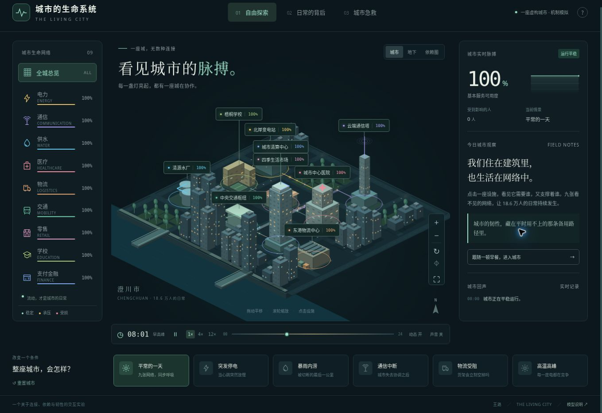

# 城市的生命系统 · The Living City

**进入一座会呼吸的城市，观察看不见的网络，亲手改变它的命运。**

作者：王路

在线体验：
https://wanglu2016.github.io/city-life-systems/



这是一座虚构的「澄川市」。18.6 万人的日常，由电力、通信、供水、医疗、物流、交通、零售、学校、支付金融九大网络共同支撑。

## 体验

- **自由探索**：拖动、缩放与旋转等距城市。点选九座主设施，查看依赖关系、服务能力和缓冲储备；暂停设施，观察影响传播。
- **三种视图**：城市、地下管网与有向网络依赖图。粒子呈现资源流动，灯光、交通和实时指标随模拟状态变化。
- **日常的背后**：跟随「一顿早餐」「一次急救」「上学的一天」走过多个系统，理解日常生活背后的协作。
- **城市急救**：用 10 点资源搭配备用电源、应急通信、应急水源、应急通道、人工结算与联动抢修；在模拟 30 分钟后将基本服务恢复到 83%。
- **六个情景**：平常的一天、突发停电、暴雨内涝、通信中断、物流受阻、高温高峰。
- **时间与氛围**：一天时间滑杆，1× / 4× / 12× 模拟速度，暂停、昼夜变化、沉浸漫游、可选环境音与减少动态效果。
- **手机与无障碍**：自适应布局、键盘控制、语义化设施选择按钮、状态播报；自动尊重系统的减少动态效果偏好。

## 启动

纯 HTML / CSS / Canvas / 原生 JavaScript 模块，无外部依赖，无账号，无数据采集。

```sh
python3 -m http.server 8080
# 浏览器打开 http://localhost:8080
```

由于浏览器对 ES Module 的安全要求，请通过 HTTP 访问，不能直接双击 index.html。完成加载后，运行不需要外部网络。可部署到 GitHub Pages 或任意静态托管。

```sh
npm test       # Node.js 18+；检验级联、缓冲、修复、资源约束和所有故障情景可解性
npm run build  # 生成 dist/，不需要 npm install
```

### 操作

| 操作 | 效果 |
| --- | --- |
| 拖动城市 / 方向键 | 平移 |
| 滚轮 / ＋ / − | 缩放 |
| Q / E / 旋转按钮 | 旋转视角 |
| 点击设施 / 左侧网络 | 选择系统 |
| 空格 | 暂停 / 继续模拟（画布或页面焦点） |
| 沉浸按钮 / Esc | 进入 / 退出漫游 |
| 复位视角 | 回到初始镜头 |
| 重置城市 | 清除故障与措施，恢复初始状态 |

## 模型假设

这是解释城市依赖关系的教学沙盒。城市、人口、能力百分比、缓冲时长、依赖权重、应急资源与目标，都是明确的模型假设，不对应真实城市遥测、设备标准或灾害预测。

每个系统具有直接可用能力、上游依赖、缓冲储备与恢复惯性。直接损伤先作用于故障源；上游服务下降会逐步耗尽下游缓冲，再降低下游服务。模型按 0.25 个模拟分钟的固定步长计算，避免浏览器帧率改变结果。修复提高故障源能力，应急措施提高相应系统服务底线，恢复需要时间。

基本服务可用度是九个系统可用度的等权平均。「受到影响的人」为 186,000 ×（1 − 基本服务可用度），是服务损失的人口等价值，并非独立受灾人口统计。依赖图的箭头从供给方指向依赖方，线宽表示本模型的权重。

缓冲为聚合近似，未显式模拟单户管网、真实路由、供需守恒、医院临床过程或真实金融清算，不能用于现实应急决策。环境音由浏览器本地合成，默认关闭。

## 项目结构

```text
index.html       页面和模型说明
style.css        自适应布局与视觉设计
app.js           城市绘制、交互、故事和环境音
model.mjs        独立模拟模型、依赖图与情景数据
tests/           模型行为测试
scripts/         静态构建
```

以连接、依赖与韧性，重新看见我们生活的城市。
